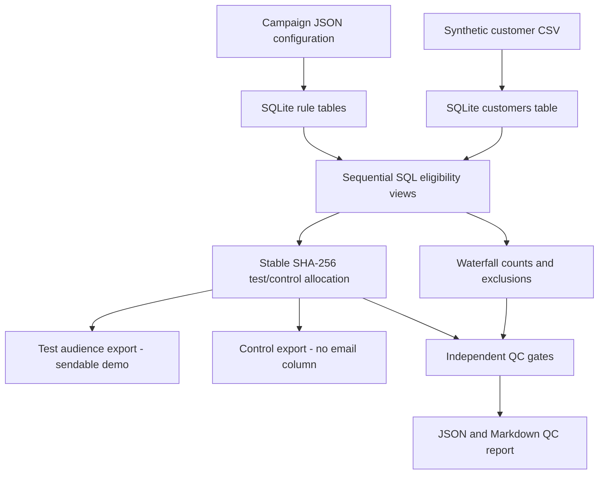

# Marketing Campaign Segmentation & QC Automation

**A reproducible portfolio project:** SQL eligibility rules, synthetic customer data, deterministic test/control holdouts, and automated quality-control waterfall reporting — with no paid services or third-party Python packages required.

[](#testing)   

> **Portfolio / educational implementation, not a production Salesforce Marketing Cloud integration.** It demonstrates campaign segmentation concepts in portable SQLite and Python. The sample data and rules are entirely fictional and do not represent employer systems, real campaigns, or real customers.

## Business problem

A marketing team needs to turn a broad starting customer population into an eligible outreach audience, record *why* customers were excluded, assign a reproducible holdout control cohort, and prevent accidental control sends. In this demonstration, eligibility is configured in JSON and implemented as **reusable SQL views**. Independent Python checks audit the results.

## Pipeline architecture



## Quick start

Requires **Python 3.10+**, no external Python dependencies for execution.

```bash
# From the repository root
python -m campaign_qc run --config config/demo_campaign.json --output out --count 3000 --seed 42

# Run automated regression tests
python -m unittest discover -s tests -v
```

To generate just a repeatable synthetic CSV:

```bash
python -m campaign_qc generate --output out/input/synthetic_customers.csv --count 3000 --seed 42
```

To use a local CSV that matches the synthetic schema, specify `--input`:

```bash
python -m campaign_qc run --config config/demo_campaign.json --input out/input/synthetic_customers.csv --output out
```

**Safety:** The example exporter includes fake `@example.com` test email addresses for illustration, and intentionally excludes email addresses from the control file. Do not connect these artifacts to a live send platform or upload production/PII datasets.

## Configurable rules

See [`config/demo_campaign.json`](config/demo_campaign.json). Ordered waterfall rules, with each customer excluded at the **first** disqualifying step:

| Order | Step | Rule |
| ---: | --- | --- |
| 0 | Starting population | All imported customers |
| 1 | Active accounts | `is_active = 1` |
| 2 | Eligible product | `product_type IN eligible_products` |
| 3 | Allowed country | `country IN allowed_countries` |
| 4 | Consent | `marketing_opt_in = 1` |
| 5 | Valid email | `has_email = 1` and non-blank email |
| 6 | Employee exclusion | `is_employee = 0` |
| 7 | Legacy exclusion | `is_legacy_subscriber = 0` |
| 8 | Promotional exclusion | `is_promotional_exclusion = 0` |
| 9 | Contact limit | `contacts_30d < max_contacts_30d` |
| 10 | Account age | `account_age_days >= min_account_age_days` |

The filter SQL lives in [`sql/stages.sql`](sql/stages.sql); SQLite schema and integrity constraints live in [`sql/schema.sql`](sql/schema.sql). Source rows may fail more than one condition, but waterfall exclusions never double-count them.

### Test/control assignment

After applying filters, each eligible customer gets a stable bucket:

`bucket = first_8_bytes(SHA256(campaign_id + "|" + customer_id)) % 10000`

Buckets below `holdout_percent * 100` map to `CONTROL`; all others map to `TEST`. For a 20% holdout, this yields **approximately** 20% controls (never a promised exact count). Identical IDs and campaign IDs are assigned consistently regardless of source CSV row ordering. Unique cell codes follow `{campaign_id}_{product_type}_{segment}`. Controls are excluded from the test export.

## Output files

Running the demo produces the following under `out/` (ignored by Git):

```text
out/
├── input/synthetic_customers.csv   # fake, deterministic records
├── campaign.sqlite3              # queryable pipeline tables and views
├── waterfall.csv                 # remaining & excluded at each step
├── qc_report.json                # machine-readable QC gate status
├── qc_report.md                  # human-readable waterfall / QC
└── exports/
    ├── sendable_test.csv         # fake email, test rows only
    └── holdout_control.csv       # control identifiers, no email column
```

See [`examples/`](examples/) for a verified sample waterfall and QC report from the included demo run.

## Automated quality gates

1. Waterfall monotonicity and exclusion reconciliation
2. Exactly one allocation per eligible customer
3. Independent Python eligibility versus SQL eligibility agreement
4. No test/control overlap
5. Stable hash assignments and correct cell codes
6. Holdout percentage within five percentage points of configured value for eligible populations of 100 or more (small samples exempt)

**Important:** The five-percentage-point rule is a *demonstration tolerance*, not a formal statistical control limit. Test/control counts are not guaranteed to match an exact quota. All QC tests must pass for a successful CLI exit code; an invalid or duplicate customer row also fails ingestion.

## Testing

```bash
python -m unittest discover -s tests -v
```

Tests include synthetic-data repeatability, overlapping eligibility failures and waterfall precedence, invalid input rejection, missing-allocation tampering, export format safety, and input-order invariance. GitHub Actions CI executes the tests and end-to-end demo automatically when this is installed as a stand-alone repository.

## Project structure

```text
campaign_qc/                  Python package (generator, CLI, pipeline, independent QC)
config/demo_campaign.json     Editable campaign requirements
sql/schema.sql                SQLite tables, data constraints
sql/stages.sql                Reusable sequential audience filter views and waterfall
examples/                     Sample verified reports (not customer records)
tests/test_campaign.py        Regression and integrity tests
.github/workflows/ci.yml      GitHub Actions for stand-alone repository
```

## Design decisions and limitations

- **Portable and runnable:** Standard library Python + SQLite. No Salesforce login is required.
- **Single definition of eligibility:** Test exports and waterfall both query the same SQL views; Python independently re-evaluates the rules as a QC gate.
- **Control protection:** No control IDs appear in the test export; the control CSV excludes email addresses.
- **Privacy by design:** Customer IDs and email addresses are synthetic, using the reserved example.com domain.
- **Not Salesforce SQL:** SQLite supports features and syntax different from SFMC SQL Query Activities. Do not paste these views directly into Automation Studio; adaptation and platform-specific testing are required.
- **Not production-ready:** There is no consent audit history, deliverability validation, RBAC, encryption, upstream event source, or transactional send platform. The synthetic generator intentionally favors clarity over representing a real population.
- **Baseline holdout:** The hash is stable within a campaign but does not enforce product-stratified or exact-size controls. A future enhancement could introduce stratified quotas, historical contact events, or scheduling.

## License

MIT; see [LICENSE](LICENSE).
